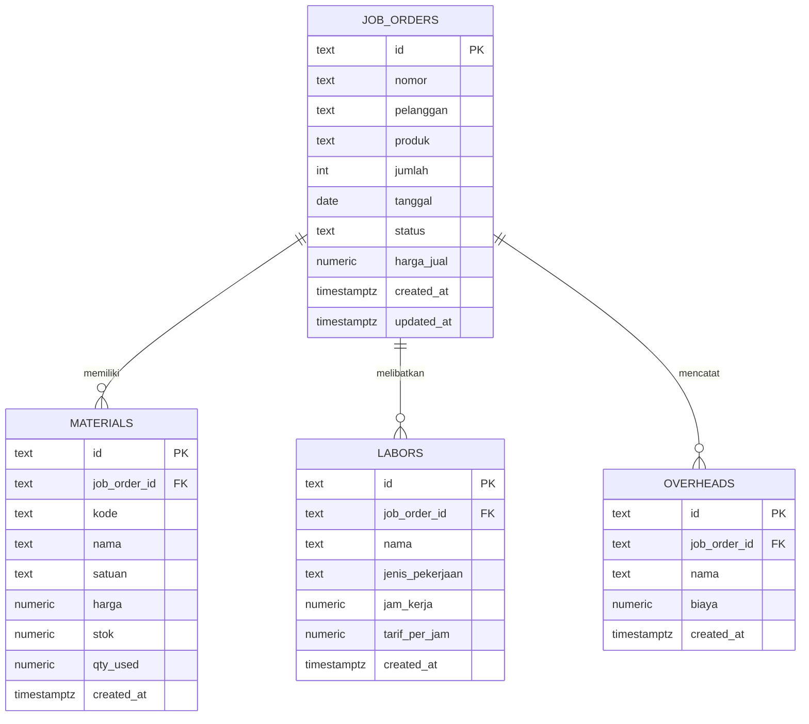

# Sistem Akuntansi Biaya Pesanan Konveksi Kaos

Aplikasi berbasis web untuk membantu pengelolaan pesanan dan pencatatan biaya produksi pada usaha konveksi dan sablon kaos custom menggunakan metode *Job Order Costing*.

  <a href="https://jovitaandini70-cloud.github.io/Sistem-Akuntansi-Biaya-Pesanan-Konveksi-Kaos/">
    <strong>🌐 https://jovitaandini70-cloud.github.io/Sistem-Akuntansi-Biaya-Pesanan-Konveksi-Kaos/</strong>
  </a>

## 1. Deskripsi Sistem

Sistem Akuntansi Biaya Pesanan Konveksi Kaos merupakan aplikasi yang dirancang untuk mendukung pengelolaan data pesanan, pencatatan komponen biaya produksi, dan penyajian informasi biaya melalui laporan.

Dalam usaha konveksi dan sablon kaos custom, setiap pesanan dapat memiliki spesifikasi produk, jumlah produksi, serta kebutuhan biaya yang berbeda. Oleh karena itu, pencatatan biaya berdasarkan masing-masing pesanan diperlukan agar biaya produksi dapat ditelusuri secara lebih terstruktur.

Aplikasi ini terintegrasi dengan Supabase sebagai backend dan PostgreSQL sebagai basis data untuk mendukung penyimpanan serta pengelolaan data sistem.

## 2. Tujuan Pengembangan

- Membantu pengelolaan data pesanan pelanggan secara terstruktur.
- Mendukung pencatatan biaya produksi berdasarkan pesanan.
- Mengelompokkan biaya bahan, tenaga kerja, dan overhead.
- Mempermudah penelusuran komponen biaya produksi.
- Menyediakan informasi biaya untuk mendukung evaluasi kegiatan produksi.

## 3. Fitur Utama

| Fitur | Deskripsi |
|---|---|
| Dashboard | Menampilkan ringkasan informasi sistem untuk membantu pemantauan aktivitas pesanan. |
| Data Pesanan | Mengelola informasi pesanan, pelanggan, produk, jumlah, tanggal, status, dan harga jual. |
| Kartu Biaya | Mendukung pencatatan biaya bahan, tenaga kerja, dan overhead berdasarkan pesanan. |
| Laporan | Menyajikan ringkasan informasi berdasarkan data yang tersedia dalam sistem. |

## 4. Sistem Akuntansi Biaya Pesanan (*Job Order Costing*)

*Job Order Costing* merupakan metode pengumpulan biaya produksi berdasarkan pesanan tertentu. Metode ini sesuai untuk usaha konveksi dan sablon kaos custom karena setiap pesanan dapat memiliki karakteristik biaya yang berbeda.

Biaya produksi dikelompokkan menjadi tiga komponen utama:

| Komponen Biaya | Penjelasan |
|---|---|
| Biaya Bahan Baku | Biaya bahan yang dapat ditelusuri secara langsung ke pesanan, seperti kain dan bahan utama produksi. |
| Biaya Tenaga Kerja | Biaya tenaga kerja yang berkaitan dengan pengerjaan pesanan. |
| Biaya Overhead Pabrik | Biaya produksi selain bahan baku langsung dan tenaga kerja langsung. |

Rumus dasar total biaya produksi:

**Total Biaya Produksi = Biaya Bahan Baku + Biaya Tenaga Kerja + Biaya Overhead Pabrik**

Harga pokok produksi per unit dapat dihitung dengan membagi total biaya produksi dengan jumlah unit yang diproduksi, apabila data yang diperlukan tersedia.

## 5. Alur Sistem

1. Pengguna membuka Dashboard untuk melihat ringkasan informasi.
2. Pengguna mengelola pesanan melalui menu Data Pesanan.
3. Komponen biaya dicatat berdasarkan pesanan melalui Kartu Biaya.
4. Data yang tersedia digunakan untuk menyajikan informasi melalui menu Laporan.
5. Informasi biaya dapat digunakan untuk membantu evaluasi biaya produksi setiap pesanan.

## 6. Entity Relationship Diagram (ERD)

ERD menggambarkan struktur basis data dan hubungan antartabel dalam sistem.

### Deskripsi Tabel Database

| Nama Tabel | Fungsi |
|---|---|
| `job_orders` | Menyimpan informasi pesanan, nomor pesanan, pelanggan, produk, jumlah, tanggal, status, dan harga jual. |
| `materials` | Menyimpan data bahan, kode, nama, satuan, harga, stok, dan kuantitas bahan yang digunakan. |
| `labors` | Menyimpan data tenaga kerja, jenis pekerjaan, jam kerja, dan tarif per jam. |
| `overheads` | Menyimpan data biaya overhead yang berkaitan dengan pesanan. |

### Relasi Antartabel

- `job_orders` merupakan tabel utama untuk data pesanan.
- `materials` terhubung ke pesanan melalui kolom `job_order_id`.
- `labors` terhubung ke pesanan melalui kolom `job_order_id`.
- `overheads` terhubung ke pesanan melalui kolom `job_order_id`.

Setiap tabel komponen biaya memiliki kolom `job_order_id` sebagai foreign key yang merujuk ke tabel `job_orders`.

## 7. Teknologi Pengembangan

| Komponen | Teknologi | Fungsi |
|---|---|---|
| Frontend | React, TypeScript, Vite | Membangun antarmuka aplikasi web. |
| Styling | Tailwind CSS | Mendukung pengaturan tampilan antarmuka. |
| Backend | Supabase | Menyediakan layanan backend dan akses basis data. |
| Database | PostgreSQL | Menyimpan dan mengelola data aplikasi. |
| Hosting | GitHub Pages | Menyediakan akses ke website aplikasi. |

## 8. Manfaat Sistem

- Membantu pencatatan pesanan dan biaya produksi secara terstruktur.
- Mempermudah penelusuran biaya berdasarkan pesanan.
- Mendukung pengelompokan biaya bahan, tenaga kerja, dan overhead.
- Membantu pemantauan dan evaluasi biaya produksi.
- Menyediakan informasi untuk mendukung pengambilan keputusan usaha.

## 9. Integrasi Basis Data

Sistem menggunakan Supabase dengan PostgreSQL sebagai basis data. Struktur utama terdiri atas tabel `job_orders`, `materials`, `labors`, dan `overheads`.

Data bahan, tenaga kerja, dan overhead dikaitkan dengan pesanan melalui kolom `job_order_id`. Pengelolaan data mengikuti struktur dan konfigurasi yang diterapkan pada aplikasi.

## 10. Penutup

Sistem Akuntansi Biaya Pesanan Konveksi Kaos merupakan implementasi konsep akuntansi biaya dalam aplikasi berbasis web. Melalui fitur Dashboard, Data Pesanan, Kartu Biaya, dan Laporan yang terintegrasi dengan Supabase, sistem ini dirancang untuk mendukung pengelolaan pesanan dan pencatatan biaya produksi berdasarkan metode *Job Order Costing*.
